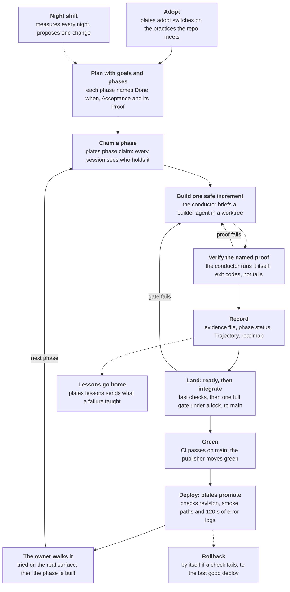
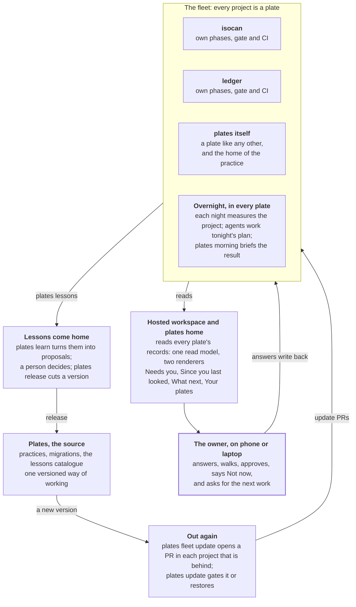

# How plates works

Every project is a plate. Plates keeps one shared way of working current
across all of them, runs the bounded work the owner allows, and brings back
only the decisions that need a person.

It does three jobs: it is the source of the practice, it carries practice
changes out to each project as a reviewable update, and it is where each
project's lessons come home. A project never depends on plates at runtime: its
workflows run from its own repo, with its own copies of the scripts.

## The parts

Each part exists because a project once paid for its absence.

| Part | What it is | The failure it prevents |
| --- | --- | --- |
| Practices | Versioned ways of working in `practices/` (base, phases, evidence, ci, night, delivery and more), rendered into each project; `.plates/plates.json` records which are on | Each project copying the practice by hand and drifting |
| Goals and phases | `docs/goals.json` says what the work is for; one file per phase in `docs/phases/` owns its status, its Done when, Acceptance and Proof; the roadmap is generated | Status written in two places; a spec that cannot be proven |
| Claims | `plates phase claim <n>` pushes `claims/phase-<n>`, visible to every session and provider | Two sessions building the same phase |
| The conductor (`/spin`) | A session that briefs a builder agent, then verifies the named proof itself before writing the record | Trusting a builder's "tests pass" |
| Evidence | `built` needs a dated evidence file saying what was actually run, with exit codes | Claiming what was never run |
| `plates ready` and `plates integrate` | `ready` runs a change's fast checks; `integrate`, one at a time under a lock, runs the full gate once on every ready change, pushes them to main together, and records each run on `plates-integrations` | Two full gates racing; ungated pushes |
| `green` and `plates promote` | A publisher moves `green` to the newest main commit whose CI passed; `plates promote` deploys it, checks the revision, the smoke paths and 120 s of error logs, and rolls back by itself on any failure | Deploying a commit before its gate; a bad deploy staying up |
| The night shift | Each project measures itself nightly, writes a health page and opens at most one PR; overnight agent work follows a plan the owner shaped with `plates goodnight`; `plates morning` briefs the result | Guards that fire into an empty room; unread machine PRs piling up |
| Walks | A short guided test the owner does on the real surface (a phone, a browser); a phase that names one is not built until it is walked | Shipping what no person has tried |
| Lessons | Failure shapes, each with the guard that now catches it; `plates lessons` sends a project's new ones home, `plates learn` turns them into proposals | Paying for the same bug twice |
| Hosted workspace and `plates home` | One read model, two renderers: the CLI and the web show the same Needs you, Since you last looked, What should happen next? and Your plates | A web view and a CLI view that disagree |

## The life of a plate

A plate is one project. Each phase travels the same path from claim to walk,
and nothing is called built until its named proof has run and, where the phase
names one, the owner has walked it.

Three loops keep it honest: a failed proof goes back to the builder, a failed
gate sends the change back to its branch, and a failed deploy check rolls
production back by itself. The dotted arrows run beside the path: the nightly
measures feed the next plan, and lessons travel home to plates.

The [Spin a phase](spin-a-phase.md) guide walks this path command by command,
and [Delivery](delivery.md) covers `green` and deploys.

## The life of a fleet

The fleet is every project under plates, plates included. Practice flows out as
a reviewed update PR in each project, lessons flow home as inbox issues, and the
owner sees all of it in one Home.

The circle at the top is how the way of working improves: a failure in one
plate becomes a lesson, a person accepts it, a release carries the guard to
every plate, and `plates update` restores the project byte for byte if its own
gate fails. The bottom is how the owner keeps up: `plates fleet` and the hosted
Home read every plate's records, and the owner's answers write back to the
plate they concern.

[Keep the fleet current](keep-the-fleet-current.md) and
[Lessons and learning](lessons-and-learning.md) cover each half of the circle.

## Where the owner comes in

The default is unattended: agents decide, record and commit everything else. A
person is needed for a short, named list, and each item reaches them in Needs
you.

- **A token or a login**: signing in, granting an App permission.
- **Money or a cloud resource (a ⚑ step)**: a new repo, a secret, scheduled
  model spend, a hosted migration.
- **A hand the phase names**: a walk on a real phone, a decision assigned to the
  owner by name.
- **Deciding what comes home**: `plates learn` proposes; a person accepts or
  declines each lesson.
- **Deploys**, when the project's grant asks for them: `plates promote --back`
  returns to the last deploy that passed.
